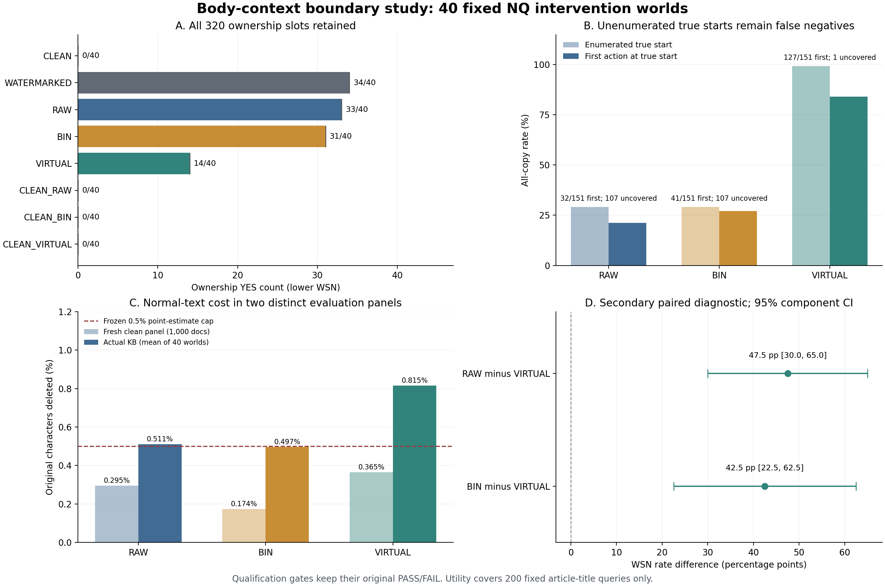

# Research progress · 2026-10-30

[简体中文](README_zh-CN.md)

This is a selective update of four recent studies, with **positive findings,
failed gates, and unmeasured outcomes retained together**. It adds to the
existing repository; the historical formal NFCorpus result **26 → 21 / 30**
remains a separate, unchanged campaign.

**The project target remains WSN ≤4, preferably ≤3, under a comparable fixed
verification protocol with damage/utility evidence. That target is not achieved.**
The newest unknown-seam method has WSN **14/40** and fails the low-damage joint
qualification. A completed experiment or a passing evidence audit is not a
completed research objective.

## 1. Body-context qualification: measured deletion, failed damage gates

All three methods share the same metadata-bound body-context eligibility rule,
initial backward depth 3, first acceptance, and one full original-target deletion
per document. The rule filters candidates after enumeration without refilling
or reranking. GainRatio remains the primary score; Lu/Lc are its internal terms.
Each method receives its own clean-only threshold under the same predeclared
document/character budget. True locations and verifier outcomes do not select
candidates or thresholds.

| Same NQ40 campaign | Ownership YES (WSN) | NO | Unknown |
|---|---:|---:|---:|
| Watermarked, untreated |34|6|0|
| RAW |33|7|0|
| BIN |31|9|0|
| VIRTUAL_GR |14|26|0|
| CLEAN |0|40|0|
| CLEAN_RAW |0|40|0|
| CLEAN_BIN |0|40|0|
| CLEAN_VIRTUAL_GR |0|40|0|

All 320 slots retain all 40 units, including untreated NOs and the original
fallback unit. Verification used 213 HTTP attempts, 212 successful responses,
and 428 exact unit/role/body-cache reuses across 640 logical requests. All
ownership flags are known; one verifier transport-attempt fee remains unknown.
Across generation and verification: 4,041 attempts, 4,034 successes, **7 unknown
attempt-fee items**, and 1,603,407 reported tokens; monetary cost was not provided.

Relative to RAW, the new WSN rate is lower by **47.5 percentage points**, paired
unit-component bootstrap 95% CI **[30, 65] pp**. Relative to BIN: **42.5 pp**,
CI **[22.5, 62.5] pp**. These are registered secondary diagnostics.

| Method | First action at true start / all 151 copies | Unenumerated FN | Complete payloads removed /151 | Actual normal-character damage |
|---|---:|---:|---:|---:|
| RAW |32|107|36|0.51053%|
| BIN |41|107|46|0.49665%|
| VIRTUAL_GR |127|1|126|0.81528%|

The primary first-action localization difference versus RAW is **+62.91 pp**,
two-way unit/source-component bootstrap 95% CI **[43.62, 78.67] pp**: **PASS**.
All true starts absent from enumeration remain false negatives. Correct start,
complete payload deletion, and ownership response are distinct endpoints.

The actual VIRTUAL_GR normal-character cost **0.81528% exceeds the frozen 0.5%**
cap. RAW also exceeds that cap; BIN stays within its absolute cap. On the new
independent 1,000-document clean panel, absolute character costs are
0.29530% / 0.17351% / 0.36536% (RAW/BIN/VIRTUAL_GR), but the new method's paired
relative character-damage CI gates fail. Both failures remain failures.

Post-hoc frozen-mask decomposition finds 22 false-action documents / 4,752
characters in the same unmarked KB. In intervention worlds, **99.902% of normal
damage comes from ordinary, unmodified source documents**, while injected-host
normal text contributes 4.65 characters per world on average. This describes the
observed cost; it does not fit or validate a new rule.

The 200 fixed article-title-query proxy gates pass; the new nDCG@10 difference
is -0.00002796, CI [-0.00019125, 0.00014031]. **Official independent NQ QA/qrels
and general retrieval utility are not established.** Forty intervention worlds
share one 1,000-document source KB; they are not 40,000 independent clean documents.

**Scientific status: `SCIENTIFIC_GATE_FAILED_WITH_SEPARATE_WSN_DIAGNOSTICS`.**

## 2. Controlled sentence seam: mechanism evidence, not an unknown-seam attack

This separate NQ40 experiment adds one period at the known construction join,
while preserving the existing selector, cutoff, and deletion policy.

| Arm | Untreated WSN /40 | RAW WSN /40 | BIN WSN /40 |
|---|---:|---:|---:|
| SPACE |31|27|26|
| PERIOD |32|13|5|

Unknown=0. Primary RAW erasure difference-in-differences is **+37.5 pp**, paired
95% CI [20,55] pp, exact sign-flip p=0.000728607. All preregistered primary
mechanism gates pass. This controlled known-seam result **5/40** cannot replace
the newest unknown-seam **14/40**, the historical NF30 result, or Oracle A4/B3.
There is no universal normal-damage cap in this mechanism experiment. Its clean
FPR, actual normal-damage changes, and title proxy remain in the frozen JSON;
the mechanism result is not a low-damage qualification or general utility claim.

## 3. Earlier virtual-boundary continuation: clean-gate failure retained

On its own independent 1,000-document panel, RAW/BIN/VIRTUAL_GR false actions
were **19/27/34**, with original-character costs **0.80742% / 0.67925% / 1.06769%**.
All exceed the 0.5% cap. Scientific status remains
`CLEAN_GATE_FAILED_NO_WATERMARK_EFFICACY_MEASURED`; treatment WSN is
**`NOT_RUN_GATE_FAILED`**, not zero. Do not compare these different panels as a
causal before/after improvement of the new body-qualified method.

## 4. Offline attribution: useful diagnosis, no new efficacy measurement

In 30 extra false-action documents, 27 metadata-only contexts account for
5,375 / 5,772 added deleted characters (**93.12%**): 26 title-to-body cases and
one title-internal case. The remaining three body-internal errors are retained.
New GPU/NLL/API/embedding/WSN calls: **zero**. The resulting body-context
hypothesis was subsequently tested in study 1, whose failed damage gates are
reported above. The post-hoc attribution does not itself establish low damage
or watermark removal.

## Evidence and reproduction

- Frozen result JSONs and original-evidence receipts are preserved byte for byte.
- `body_context_boundary/PUBLIC_PROTOCOL_PROJECTION.json` is an explicitly
  labeled public projection, with the original frozen protocol SHA256 retained;
  it is not presented as the original protocol bytes.
- Derived per-unit, per-copy, per-world, and clean-document CSVs preserve the
  full measured denominators without releasing corpus text, generated entity
  triples, API request/response bodies, keys, or SQLite/model files.
- CPU reference components and tests: [`../../../src/experiments/body_context_boundary_20261029`](../../../src/experiments/body_context_boundary_20261029).
  From the repository root run `python results/extensions/research_progress_20261030/verify_public_update.py`.
- The complete local-evidence package passed **61,078** independent CPU checks;
  this public subset supports aggregate recomputation but does not replay
  withheld hosted-model responses or the full original model run.
- New body-study NLL primitives: 11,812; Qwen effective input tokens: 922,653;
  boundary documents: 2,151 new / 1,016 reused; new Contriever vectors: 1,426.
  Engineering/calibration forwards were reused exactly. No new index was built.

Scope of this publication: the four studies above. Earlier results already in
this repository remain unchanged; this is not a claim that every internal run
has been publicly released. No experiment was rerun to prepare this update.
